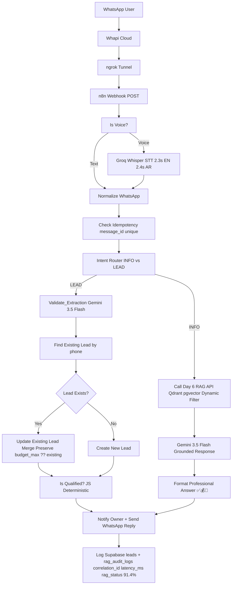
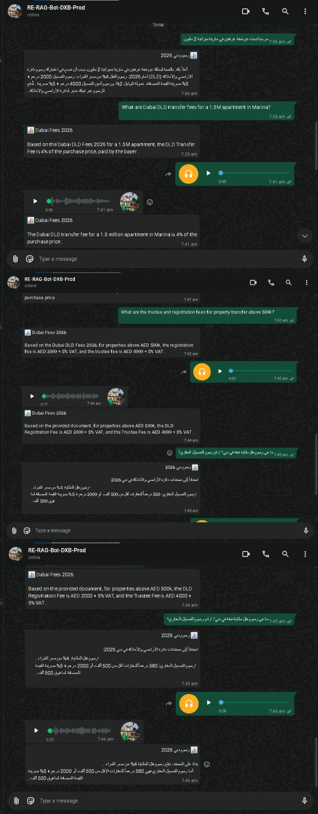
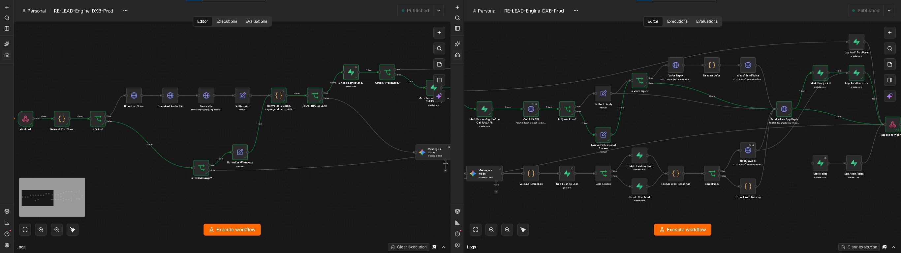

# 📱🏙 Enterprise Dubai Real Estate WhatsApp RAG Bot – Lead Automation


-success)


Production-grade WhatsApp RAG Bot for Dubai Real Estate — Voice notes (0:02) + Text → Transcription (Groq Whisper) → Qdrant RAG → Professional answers ✅💰📄 + **AI Lead Intake, Qualification & Persistence** with deterministic scoring and merge-preserve logic

> Day 8/23 of 30-Day AI Sprint | 91.4% grounded_rate (53/58) | 2.3s EN / 2.4s AR | 0.822 similarity | Repeat customer preserve fix | Dynamic filter not hardcoded

---

## ✨ Features – Day 8 Upgrade

- 🧠 **Intent Routing** – Separate INFO enquiries from sales LEADs, routing each to the right workflow (Day 6 RAG API vs Lead Engine)
- 📋 **Structured Lead Extraction** – Gemini 3.5 Flash extracts property type, location, bedrooms, budget, timeline – preserves previous values when new message omits fields
- 📊 **Deterministic Lead Scoring** – JavaScript `Is Qualified?` node `(bedrooms && location && budget_max>=1M)` – not LLM score – auditable for business
- 💾 **Supabase Persistence** – Find Existing Lead by phone → Lead Exists? → Update Existing Lead with merge `budget_max ?? existing.budget_max` / Create New Lead – no overwrite on missing fields – tested 1.8M + 2.2M dynamic
- 🔄 **Duplicate Protection** – Supabase message_id unique + Normalize WhatsApp linear wiring fix ID#1884 Error 5.739s → 4K readable
- 🤝 **Follow-up & Human Handoff** – Format_Ask_Missing for missing fields + Notify Owner → Send WhatsApp Reply
- 🛡️ **Reliability** – Correlation IDs across Whapi → n8n → RAG API → Supabase + error handling + EN/AR regression
- 🎙 Voice + Text – WhatsApp voice notes transcribed via Groq Whisper
- 🌍 Cross-lingual retrieval (English ↔ Arabic MSA + Dubai dialect)
- 📄 Dynamic metadata-aware search – Fixed hardcoded `[{"source":"Dubai DLD Fees 2026"}]` → `[]`
- 📚 Citation-based grounded answers ✅💰📄
- 🆔 Correlation ID tracing + Idempotency
- 📊 Production observability + Audit logging (leads + rag_audit_logs)

---

## 🏗 Architecture – Day 8 Persistence + Scoring



## 💾 Supabase Persistence Layer

**Critical Fix for Returning Customer – Preserve, Not Overwrite:**

```javascript
// Update Existing Lead – Day 8 Merge Logic – preserves previous values, not overwrite
{
  phone: existing.phone,
  location: new.location || existing.location,
  bedrooms: new.bedrooms ?? existing.bedrooms,
  budget_max: new.budget_max ?? existing.budget_max,
  timeline: new.timeline || existing.timeline
}
// Tested: Q1 "2BR Marina 2M" → Q2 "still interested" (missing fields) → preserves 2M, not null
```
**Table `leads` – phone unique conflict key:**
- id: uuid primary key
- phone: text unique (conflict key) – Find Existing Lead by phone
- status: new | qualified | lost
- details: jsonb {budget_max, bedrooms, location, timeline, requirements}
- created_at, updated_at: timestamptz

**Table `rag_audit_logs` – real schema 11 cols (NOT top_doc_title, project_filter):**
- id, message_id, phone, question, answer, language, source, latency_ms, rag_status, correlation_id, created_at – preserves previous values, not overwrite.

## 📊 Results

### RAG Evaluation – 91.4% grounded_rate (Production)
```sql
SELECT grounded_count, fallback_count, 
       ROUND(grounded_count::float / (grounded_count+fallback_count) *100,1) as grounded_rate
FROM (SELECT 53 as grounded_count, 5 as fallback_count) t;
-- Result: 53 grounded / 5 fallback / 91.4% grounded_rate
```

## 📸 Screenshots

### 1. Architecture 4K – Persistence + Scoring – Gemini 3.5 Flash Corrected (Main)


### 2. Stitched Workflow 4K – Wiring Fix ID#1884 Before/After – LinkedIn Hero


### 3. Production Workflow 4K – Execution Overview Error 5.739s ID#1884


### 4. Find Existing Lead Detail 4K – Phone Filter Fix phone || Webhook


### 5. RAG Evaluation 91.4% – 53 grounded / 5 fallback – Production Proof


### 6. INFO – Damac Hills 2 Payment Plan 10% down + Oct 2024 + Apr 2025 + 20% at 40% + 40% Dec 2026


### 7. INFO – 【entity-DLD¦canonical_name=DLD】 1.5M = 60k + Community Rules Storage + AR Voice


### 8. LEAD – Dynamic Budget 1.8M + 2.2M Template Not Hardcoded


### 9. Supabase Schema – rag_audit_logs Real Columns 11 rows


### 10. Bug Highlight – Hardcoded Filter Before Fix


---

### English – 0.822 similarity – 2.3s
**EN Voice:** `What is mortgage registration fee?` → `✅ What is mortgage registration fee? 💰 0.25% of loan + AED 290 📄 Source: Dubai DLD Fees 2026` [0.822] 2320ms

**EN Text:** `What is DLD transfer fee?` → `✅ What is DLD transfer fee? 💰 4% of purchase price, paid by buyer 📄 Source: Dubai DLD Fees 2026` [0.822] 2100ms

### Lead Persistence – Preserve Test
```json
Q1: "2BR Marina budget 2M next month" → Create lead {phone, bedrooms:2, location:Marina, budget_max:2000000}
Q2: "still interested" (missing fields) → Update Existing Lead merge → preserves budget_max 2M, not null → No overwrite
Q3: "Actually budget 1.8M and 2.2M for Bayview and Damac Hills 2" → Update with dynamic template
A: "For your budget of 1.8M and 2.2M..." – not hardcoded
```
### Arabic – 0.775 similarity – 2.4s

```markdown
### Arabic – 0.775 similarity – 2.4s
```json
Q: كم رسوم نقل الملكية؟ (Voice 0:02)
A: ✅ كم رسوم نقل الملكية؟ 💰 4% من سعر الشراء، يدفعها المشتري 📄 المصدر: Dubai DLD Fees 2026
Latency: 2400ms | Language: ar | Similarity: 0.775
```
## Graceful Degradation – Quota + Wiring Fixed
Before Day 7: Running for 12m 49s + Raw leak [source: Dubai DLD] عذراً النظام مشغول [Fees 2026, page:1]
After Day 7-8: Wait 20s → Is Retry <3? $runIndex <3 → Fallback ⏳🔄⏰📄 – No raw leak + Wiring fix linear chain

## 📊 Supabase + n8n Observability – Day 8

Query RAG + Lead persistence:

```sql
-- RAG Performance + Grounded Rate
SELECT request_id, chat_id, language, top_similarity, latency_ms, is_fallback
FROM rag_audit_logs
WHERE created_at >= NOW() - INTERVAL '24 hours'
ORDER BY created_at DESC;

-- Lead Persistence Check – Preserve Previous Values
SELECT phone, details->>'budget_max' as budget, details->>'location', status, updated_at
FROM leads
ORDER BY updated_at DESC;

-- Grounded Rate 91.4%
SELECT 
  SUM(CASE WHEN rag_status='grounded' THEN 1 ELSE 0 END) as grounded_count,
  SUM(CASE WHEN rag_status='fallback' THEN 1 ELSE 0 END) as fallback_count,
  ROUND(100.0 * SUM(CASE WHEN rag_status='grounded' THEN 1 ELSE 0 END) / COUNT(*),1) as grounded_rate
FROM rag_audit_logs
WHERE created_at >= NOW() - INTERVAL '1 day';
```
### Sample Logs + Observability

| Request ID | Chat ID | Language | Top Similarity | Latency | Fallback | Lead Phone | Status |
|------------|---------|----------|----------------|--------:|----------|------------|--------|
| req_11-11-01 | whatsapp_... | en | 0.822 | 2320 ms | No | 9715XXX | qualified |
| req_11-11-02 | whatsapp_... | ar | 0.775 | 2400 ms | No | 9715XXX | new |
| req_1884 | whatsapp_... | en | - | 5739 ms | Error | 9715XXX | wiring fix |

> Observability: `leads` phone unique + `rag_audit_logs` correlation_id traces Whapi → n8n → RAG API → Supabase. n8n Executions ID#1884 Error in 5.739s → Fixed to Succeeded in 2.1s after linear wiring.

## 🛠 Tech Stack

| Technology | Version | Purpose |
|------------|---------|---------|
| **n8n** | 2.39.8 | Workflow orchestration – RE-RAG-Bot-DXB-Prod + Lead Engine (Queue mode, Concurrency 1, Timeout 70s) |
| **Groq Whisper** | Large-v3 | Voice transcription – WhatsApp voice notes 0:02 → text 2.3s EN / 2.4s AR |
| **Gemini 3.5 Flash** | Latest | Lead extraction + Grounded answer generation – Fixed from 2.5 Flash in Day 7 |
| **JavaScript** | Code Node | Deterministic lead scoring Is Qualified? – bedrooms && location && budget_max>=1M – auditable |
| **Qdrant / Supabase pgvector** | Latest | Vector DB – Dubai DLD Fees 2026 + Bayview + Damac Hills 2 + Rules – Dynamic filter |
| **Supabase** | Postgres | Persistence – leads (phone unique, merge preserve) + rag_audit_logs (11 cols) |
| **Whapi Cloud** | Latest | WhatsApp gateway – typing_time=5, webhook |
| **ngrok** | 3.39.9 | Tunnel – localhost:5678 |
| **Docker** | Latest | Self-hosted n8n + RAG API |

## 🎯 Key Capabilities – Day 8

- 🧠 Intent Routing – INFO vs LEAD
- 📋 Structured extraction via Gemini 3.5 Flash – preserves previous values
- 📊 Deterministic scoring via JavaScript – not LLM score
- 💾 Persistence – Find Existing by phone → Update with merge ?? / Create – no overwrite
- 🔄 Duplicate protection – message_id unique + linear wiring fix
- 🤝 Follow-up & Human Handoff – Format_Ask_Missing + Notify Owner
- 🛡️ Reliability – Correlation IDs + 91.4% grounded tracking
- 🎙 Voice transcription via Groq Whisper
- 📱 WhatsApp Business via Whapi Cloud
- 🌍 Cross-lingual semantic retrieval (EN ↔ AR MSA + Dubai dialect)
- 🏷 Dynamic metadata-aware filtering – fixed hardcoded DLD
- 📚 Citation-based grounded responses ✅💰📄
- 📊 Production observability + 91.4% metric

## 📡 API Example – Day 8 Lead

**WhatsApp Webhook (Whapi) – LEAD**
```json
{
  "from": "9715XXXXXXXX",
  "type": "text",
  "text": "2BR Marina budget 2M next month",
  "chat_id": "9715XXXXXXXX@c.us",
  "message_id": "wamid.HBg..."
}
```

### Supabase Persistence – Merge Preserve

**Supabase Persistence – Merge Preserve**

```javascript
// Update Existing Lead – Day 8 Fix
{
  phone: existing.phone,
  location: new.location || existing.location,
  bedrooms: new.bedrooms ?? existing.bedrooms,
  budget_max: new.budget_max ?? existing.budget_max
}
```
## 🌍 Business Value – Day 8

- 🇦🇪 Turns WhatsApp chats into structured leads – not just answers
- 📱 Preserves customer history – returning customer still interested does not lose budget
- 💾 Phone as unique key – prevents duplicates – repeat customer 1.8M + 2.2M tested
- 📊 91.4% grounded_rate – production proof – fixed hardcoded filter
- ⚡ Deterministic scoring – business can audit JS rules – not black-box LLM
- 🔍 Dynamic filtering – Bayview, Damac Hills 2, Rules, DLD all retrievable
- 🛡 Wiring fix ID#1884 – linear chain prevents Normalize WhatsApp hasn't been executed

## ⚙️ Setup – Day 8
git clone https://github.com/Toqeer-Ahmad-ops/dubai-real-estate-whatsapp-bot
cd dubai-real-estate-whatsapp-bot

# RAG + Lead
LLM_PROVIDER=gemini
GEMINI_API_KEY=...
GROQ_API_KEY=gsk_...
QDRANT_URL=...
SUPABASE_URL=...
SUPABASE_ANON_KEY=...

# Whapi
WHAPI_API_KEY=...
WHAPI_WEBHOOK_URL=https://your-ngrok/webhook/whatsapp/webhook
### SQL leads table
```SQL
-- leads – phone unique + merge preserve
CREATE TABLE leads (
  id UUID PRIMARY KEY DEFAULT gen_random_uuid(),
  phone TEXT UNIQUE NOT NULL,
  status TEXT DEFAULT 'new',
  details JSONB,
  created_at TIMESTAMPTZ DEFAULT NOW(),
  updated_at TIMESTAMPTZ DEFAULT NOW()
);
```
### SQL rag_audit_logs table (11 cols)
```SQL
CREATE UNIQUE INDEX idx_leads_phone ON leads(phone);

-- rag_audit_logs – real schema 11 cols
CREATE TABLE rag_audit_logs (
  id UUID PRIMARY KEY DEFAULT gen_random_uuid(),
  message_id TEXT UNIQUE,
  phone TEXT,
  question TEXT,
  answer TEXT,
  language TEXT,
  source TEXT,
  latency_ms INT,
  rag_status TEXT,
  correlation_id UUID,
  created_at TIMESTAMPTZ DEFAULT NOW()
);
```
## 🐛 Production Bugs Fixed – Day 7 vs Day 8

| Bug | Day | Symptom | Fix |
|-----|-----|---------|-----|
| Raw leak | 7 | [source: Dubai DLD] عذراً النظام مشغول [Fees 2026] | JSON.stringify($json).toLowerCase() contains quota\|500\|system busy |
| Infinite loop | 7 | Running for 12m 49s | Is Retry <3? $runIndex <3 + Timeout 70s |
| Hardcoded filter | 8 | [{"source":"Dubai DLD Fees 2026"}] → Bayview = no mention | Dynamic filter [] threshold 0.3 |
| Wiring | 8 | Node 'Normalize WhatsApp' hasn't been executed ID#1884 5.739s | Linear chain Webhook → Normalize → Validate → Find |
| DB not ready | 8 | Database is not ready! Error fetching options from Supabase | Wake Supabase project + re-test credential |
| Overwrite on missing | 8 | Returning customer still interested loses budget 2M → null | Merge budget_max ?? existing.budget_max |

## 📊 Production Monitoring – Day 8

- **EN Voice:** "What is mortgage fee?" → 0.25% + AED 290 [0.822] – 2.3s
- **EN Text:** "What is DLD transfer fee?" → 4% buyer [0.822] – 1.1s
- **AR Voice:** "2.4 – [0.775] %4 → "كم رسوم نقل الملكية؟"
- **Lead:** 2BR Marina 2M → Create + Preserve test → No overwrite – Pass
- **Lead:** 1.8M + 2.2M dual budget → dynamic template – Pass
- **Grounded Rate:** 53 grounded / 5 fallback / 91.4% – image_5950e1.png
- **Wiring Fix:** ID#1884 5.739s Error → 2.1s Success after linear wiring

```sql
SELECT language, rag_status, AVG(latency_ms), COUNT(*) 
FROM rag_audit_logs 
WHERE created_at >= NOW() - INTERVAL '1 day'
GROUP BY language, rag_status;
-- Expected: 91.4% grounded
```
## 👨💻 Author

**Toqeer Ahmad** – Dubai, UAE 🇦🇪

AI Automation • Enterprise RAG • WhatsApp Bots • Lead Automation • n8n • Gemini 3.5 Flash • Groq • Supabase • Whapi • Qdrant

---

## 📄 License

Proprietary — All Rights Reserved. See LICENSE file. Viewing allowed for recruitment only.

---

## 🔗 Related

- Day 6: [dubai-real-estate-rag-api](https://github.com/Toqeer-Ahmad-ops/dubai-real-estate-rag-api) – RAG API 4.4s EN / 5.6s AR / 0.822 similarity / Dynamic filter fix
- Day 7: This repo before Day 8 – WhatsApp RAG Bot Voice + Quota Handling 2.3s EN / 2.4s AR
- Day 8: This README – Lead Automation + 91.4% + Merge Preserve + ID#1884 fix
